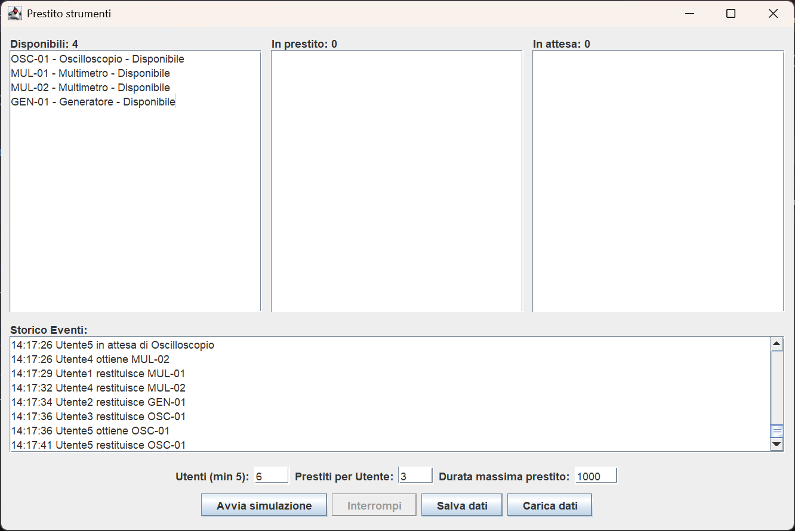
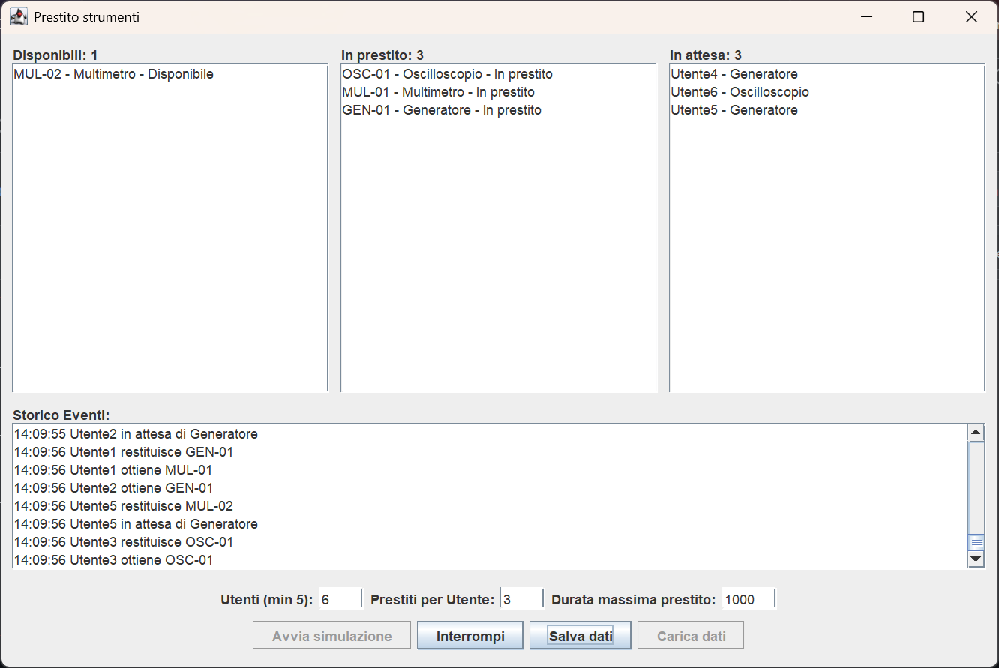

# Gestione Prenotazioni Laboratorio

Applicazione desktop in Java per la gestione concorrente del prestito di strumenti in un laboratorio didattico. 
Il cuore del progetto è un **oggetto monitor** (`synchronized`, `wait()`, `notifyAll()`) che coordina le richieste simultanee di più utenti (thread), gestendo attese e restituzioni senza race condition.

## Funzionalità Principali

* **Catalogo Strumenti:** Gestione di strumenti identificati da codice univoco, tipologia e stato (*Disponibile* / *In prestito*).
* **Simulazione Concorrente:** Esecuzione simultanea di più thread utente che richiedono e restituiscono strumenti in tempo reale.
* **Monitor & Sincronizzazione:** Gestione atomica delle assegnazioni e messa in attesa (`wait()`) dei thread quando gli strumenti sono esauriti, con risveglio (`notifyAll()`) alla restituzione.
* **Registro Eventi & Persistenza:** Storico consultabile delle operazioni e salvataggio/caricamento su file dello stato del laboratorio.

---

## Anteprima dell'Applicazione

### Schermata Principale e Catalogo


### Simulazione Concorrente in Corso


---

## Requisiti ed Esecuzione

* **Java:** JDK 22 o superiore

### Compilazione ed Avvio
```bash
# Compilazione
javac -d bin src/**/*.java

# Esecuzione
java -cp bin Main
```

---

## Autori (Progetto EPS 2026/2027)

* **Fabio Bonomelli** *(Referente)* - 750820
* **Michele Davì** - 751691
* **Stefano Rossi** - 750672
